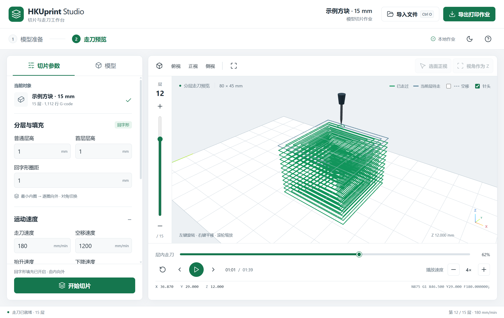
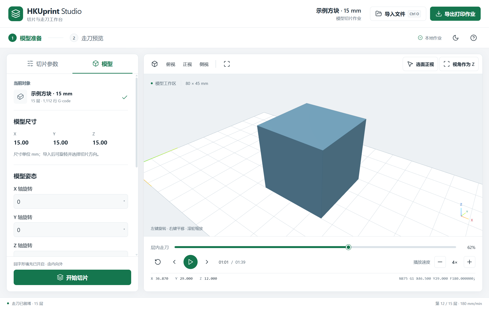
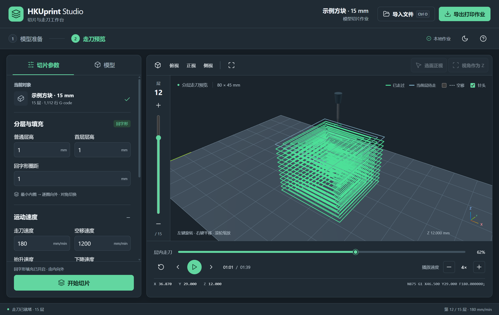

# G-code 软件

当前目录是切片和预览软件的独立工作副本。`HKUprint/Gcode view` 中另有较早版本，不应混用。

## Electron 工作台

双击 `start_hkuprint_studio.cmd`，或打开 `electron/release/win-unpacked/HKUprint Studio.exe`。

新版整合 STL/OBJ 切片与 G-code 三维走刀查看，支持大字体参数区、模型旋转与选面正视、视角作为 Z、左侧层滑块、下方走刀进度、调速播放、针头与 XYZ 轴，以及浅色/深色界面。

导出为独立打印作业目录，含 `run.gcode` 和逐层曝光 PNG。详细使用、开发和打包说明见 [electron/README.md](electron/README.md)。

左侧设置切片参数，预览窗口左边切换层，下方查看层内走刀进度并调整播放速度。绿色显示已走过的轨迹，切换到高层时保留底层路径。

## 界面预览

### 模型准备

在“模型”页调整 X、Y、Z 旋转角度；预览上方提供“选面正视”和“视角作为 Z”，用于确定切片方向。

### 深色主题

点击顶部月亮或太阳按钮切换主题，模型预览与走刀控制使用相同布局。

截图使用 15 mm 示例方块，演示层高为 1 mm。较小窗口下的布局与操作说明见 [Electron 使用文档](electron/README.md#界面与操作)。

## 原程序

- `GcodeSlicer.exe` / `start_gcode_slicer.cmd`：原 Tkinter 切片器。
- `GcodeViewer3D.exe` / `start_gcode_viewer_3d.cmd`：原 Windows OpenGL 三维查看器。
- `GcodeViewer.html` / `gcode_viewer.py`：浏览器二维查看器。

Electron 版本复用 `gcode_slicer.py` 的切片算法。实机控制台、解释器和固件位于相邻 `HKUprint/DLP` 主项目。
