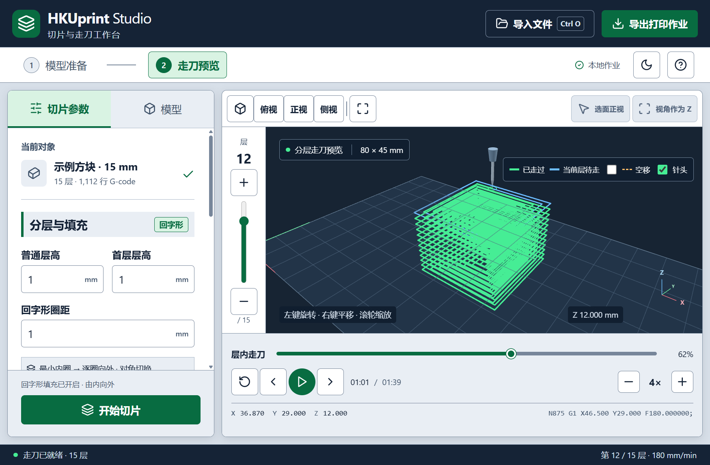

# HKUprint Studio

Electron 桌面工作台，整合模型切片和三维走刀预览。Python 后端复用上一级 `gcode_slicer.py` 的几何与导出功能，前端使用 Three.js / WebGL。

## 使用

打包后双击 `release/win-unpacked/HKUprint Studio.exe`。必须保留同目录 DLL、resources 等文件，不能只拷贝 EXE。打包版已包含 Python 后端，不需要另装 Python 或 Node。

1. 导入 STL / OBJ，或直接导入 G-code 查看走刀。
2. 设置层高、圈距、速度、曝光与工作区；模型页提供旋转。
3. 可开启“选面正视”，单击一个面，再将视角作为 Z 切片方向。
4. 开始切片。左侧滑块选层，下方滑块查看当前层进度，支持播放、单步和 0.25–32 倍速。
5. 导出打印作业，得到新的独立目录，内含 `run.gcode` 与编号曝光 PNG。已有目录自动加后缀保留。

该工作台处理离线文件。导出仍使用现有 DLP G-code 方言，实机坐标、归零、材料与曝光接口需通过原解释器检查。

## 界面与操作

以下截图来自实际运行的打包版，使用 15 mm 示例方块；演示层高设为 1 mm。

### 模型准备与切片方向

左侧切换到“模型”，可查看尺寸并调整 X、Y、Z 旋转角度。点击“选面正视”后选择模型面，再点击“视角作为 Z”，沿该方向切片。


### 分层走刀与播放

左侧“切片参数”包含分层与填充、运动速度、曝光与底层、工作区等分组；点击折叠标题展开。预览左边的竖向滑块切换层，下方横向滑块查看当前层进度，播放区域的减号和加号调整速度。

三维工作区采用深色背景。亮绿色线为已走过的轨迹，蓝色线为当前层待走路径，开启“空移”后显示琥珀色虚线。查看更高层时，底层已完成轨迹继续显示；银色针头跟随当前走刀位置，右下角提供 XYZ 方向标识。


### 深色主题

点击顶部主题按钮切换浅色与深色界面。


### 较小窗口布局

缩小窗口后，参数面板可上下滚动，层滑块、层内进度、播放和速度按钮仍保留在预览区域。



## 开发

需要 Node.js 22+ 与带 Tkinter 的 Python 3.10+。在本目录执行：

```powershell
npm install
npm run dev
```

`npm start` 构建并打开正式界面；`npm test` 检查解析和 Python 切片/导出；`npm run smoke` 启动隐藏 Electron 窗口，完成真实切片、滑块、失效保护、导出及截图检查，产物保存在 `artifacts/`。

若 Python 不在 PATH 中，可设置环境变量 `HKUPRINT_PYTHON` 为实际 Python 可执行文件路径。

```powershell
npm run package
```

打包需要 Python 环境中的 PyInstaller，以及首次下载 Electron 打包工具的网络访问。打包输出在 `release/win-unpacked/`。

## 文件

- `main.cjs` / `preload.cjs`：Electron 窗口、原生文件对话框与受限 IPC。
- `backend/hku_backend.py`：JSON-lines 后端协议，模型导入、参数检查、切片与作业导出。
- `src/app.js` / `src/style.css`：中文界面、操作状态与主题。
- `src/viewport.js`：三维模型、选面、针头和路径 GPU 缓存。
- `src/gcode.js` / `src/parse-worker.js`：G-code 解析与后台计算。
- `tests/` / `backend/test_backend.py`：核心流程回归。
